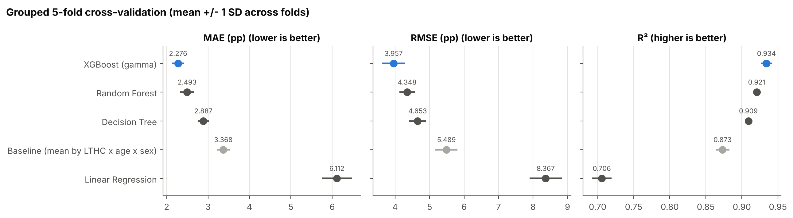
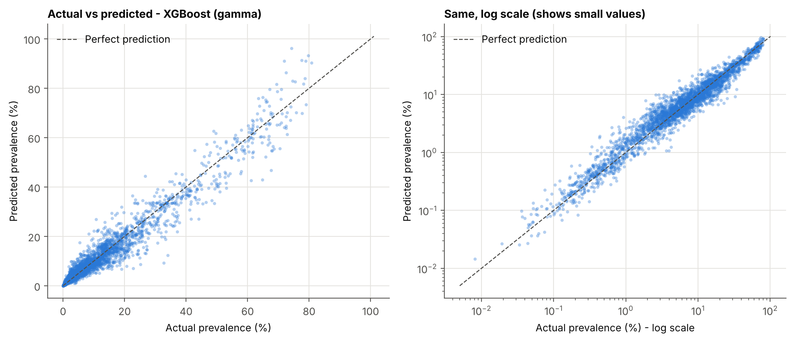
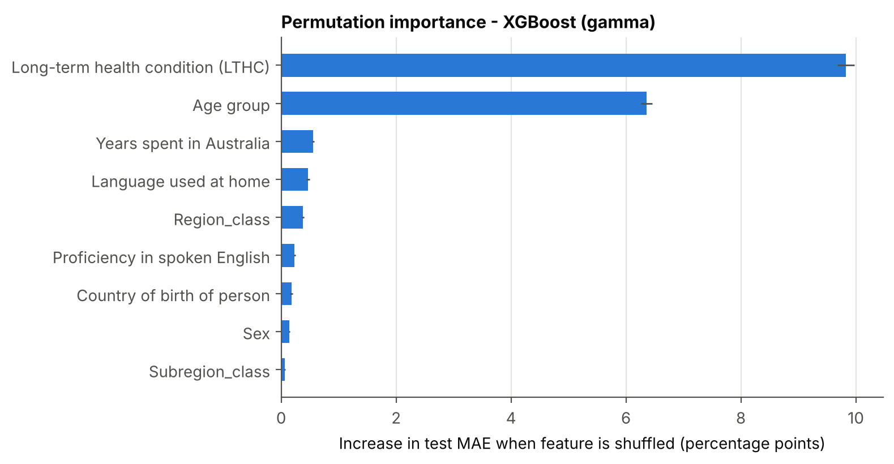
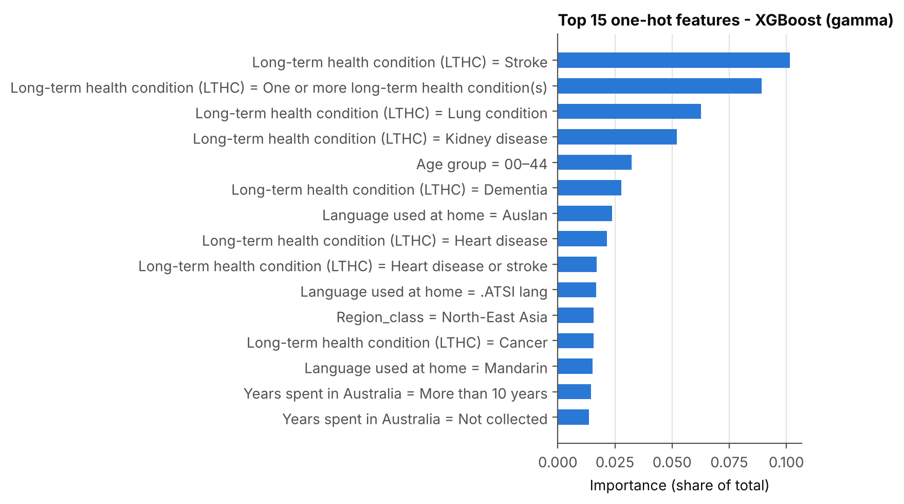
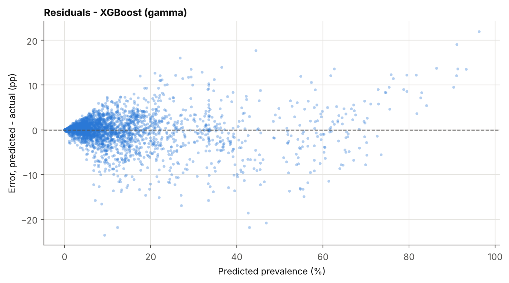
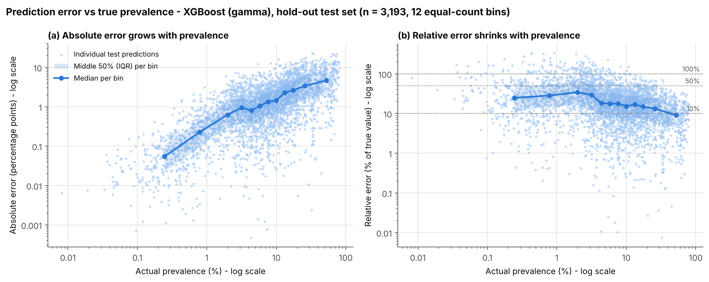
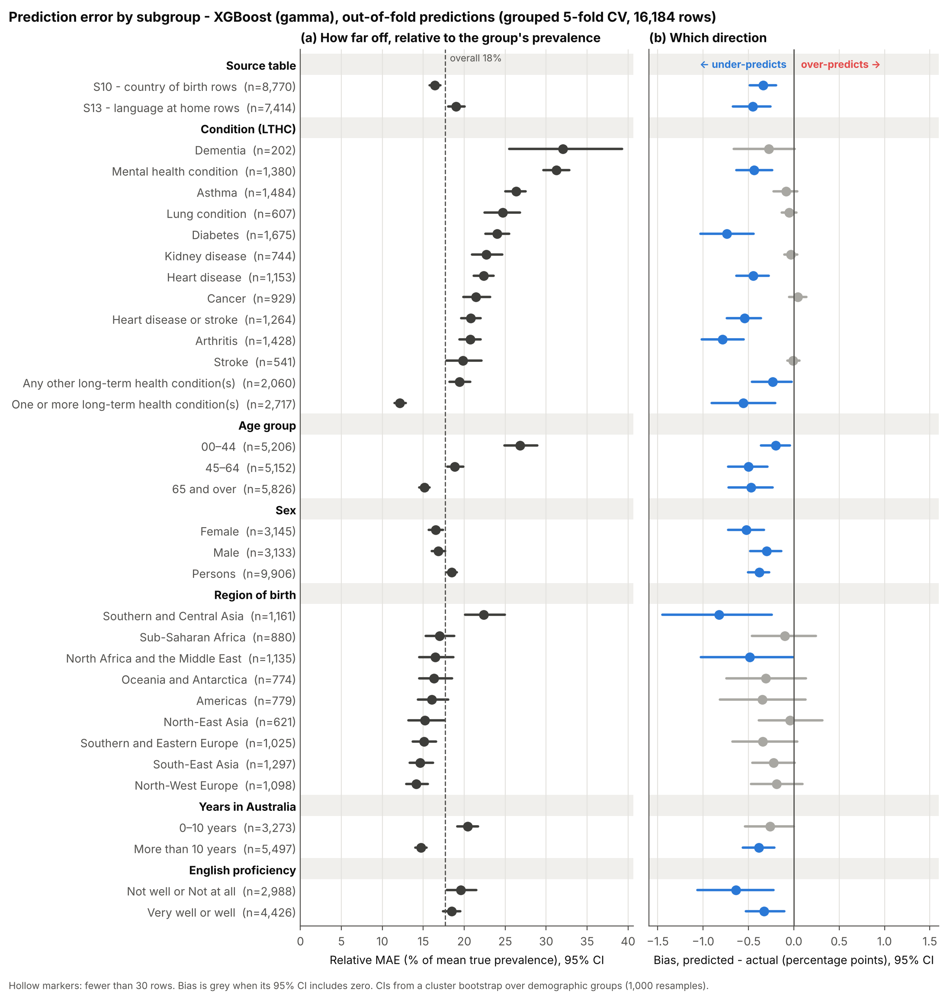

# Model Evaluation, Feature Importance and Error Analysis

All figures and results in the first four sections are produced by four scripts, run in order with `random_state = 42`: `Data_Cleaning.py`, `Model_training_evaluation.py`, `Error_plotting.py` and `Demographic_error.py`. The data are the 16,184 published cells from AIHW Tables S10 (country of birth) and S13 (language used at home). The two tables are kept as separate sources with no country–language imputation, variables a table did not collect are labelled "Not collected", and suppressed ("n.p") cells are removed rather than set to zero. All errors are in percentage points (pp) of prevalence.

## Machine Learning Evaluation

Rows were grouped into 1,294 demographic groups defined by every variable except condition and sex, so a group's 13 conditions and its Persons, Male and Female rows always stay together. A grouped 80/20 split set aside 259 groups (3,193 rows) as a hold-out test set. On the remaining 12,991 rows, four models and a naive baseline (mean prevalence for each condition × age group × sex) were compared with grouped 5-fold cross-validation (MD Figure 1). XGBoost, trained with a gamma objective so every prediction is above zero, had the lowest error on every metric and beat Random Forest in all five folds, so it was selected on mean CV RMSE. Linear Regression performed worse than the baseline and produced 2,266 negative predictions.

| Model | Evaluation | MAE (pp) | RMSE (pp) | R² | Negative predictions |
|---|---|---|---|---|---|
| **XGBoost (gamma)** | Grouped 5-fold CV | **2.28 ± 0.15** | **3.96 ± 0.34** | **0.934 ± 0.008** | 0 |
| Random Forest | Grouped 5-fold CV | 2.49 ± 0.17 | 4.35 ± 0.22 | 0.921 ± 0.004 | 0 |
| Decision Tree | Grouped 5-fold CV | 2.89 ± 0.13 | 4.65 ± 0.25 | 0.909 ± 0.003 | 0 |
| Baseline (mean by condition × age × sex) | Grouped 5-fold CV | 3.37 ± 0.16 | 5.49 ± 0.32 | 0.873 ± 0.010 | 0 |
| Linear Regression | Grouped 5-fold CV | 6.11 ± 0.36 | 8.37 ± 0.47 | 0.706 ± 0.013 | 2,266 |
| **XGBoost (gamma)** | Training set (refit) | 1.70 | 2.82 | 0.967 | 0 |
| **XGBoost (gamma)** | Hold-out test set | **2.10** | **3.48** | **0.946** | 0 |
| Baseline | Hold-out test set | 3.06 | 4.78 | 0.897 | 0 |

Refitted on the full training set and scored once on the hold-out test set, XGBoost achieved MAE 2.10 pp, RMSE 3.48 pp and R² 0.946, against R² 0.897 for the baseline; the train–test R² gap is 0.021. Predictions follow the ideal diagonal from about 0.01% to 90% (MD Figure 2): 89% of test predictions are within ±5 pp of the published value and none is negative (the Assessment 3 model produced 123 negative predictions that were clipped to 0%).

*MD Figure 1. Grouped 5-fold cross-validation: MAE, RMSE and R² by model (mean ± 1 SD across folds).*

*MD Figure 2. XGBoost (gamma): actual vs predicted prevalence on the hold-out test set, linear and log scale.*

## Feature Importance

Permutation importance (MD Figure 3) shuffles one input column at a time in the test set and records how much MAE rises. Shuffling the condition raised MAE by 9.83 pp and age group by 6.36 pp, while each cultural or migration variable added 0.56 pp or less (years in Australia 0.56, language 0.47, region 0.38, English proficiency 0.23, country of birth 0.18) and sex added 0.14 pp. Region, subregion and country are derived from each other, so they share credit. XGBoost's built-in gain importance (MD Figure 4) also ranks the condition first (0.43 of the total), but places language (0.25) and country (0.11) above age group (0.05) because it rewards splits that isolate small, distinctive groups such as Auslan and Aboriginal and Torres Strait Islander language users. Permutation importance is used for interpretation: condition and age explain most of the variation, and cultural and migration variables refine the estimates.

*MD Figure 3. Permutation importance on the hold-out test set: increase in MAE (pp) when each feature is shuffled (± 1 SD over 10 repeats).*

*MD Figure 4. XGBoost gain importance: top 15 one-hot features.*

## Error Analysis

Residuals are centred on zero but their spread widens as prevalence rises (MD Figure 5). Absolute error grows with prevalence while relative error (absolute error as a percentage of the true value) falls (MD Figure 6): the median relative error is about 25–34% for true values below 4% and 9% for the highest values. The model is least accurate in percentage points for high-prevalence groups, but least accurate relative to the true value for rare conditions and younger ages.

| True prevalence band | Test rows | Mean true value | MAE (pp) | Bias (pp) | Relative MAE |
|---|---|---|---|---|---|
| 0–5% | 1,310 | 2.1% | 0.77 | +0.54 | 37% |
| 5–10% | 681 | 7.1% | 1.58 | +0.42 | 22% |
| 10–20% | 647 | 14.2% | 2.83 | −0.42 | 20% |
| 20–50% | 408 | 30.5% | 4.69 | −2.55 | 15% |
| 50–100% | 147 | 62.8% | 6.09 | −1.26 | 10% |

The model pulls extreme values towards the middle: rows at 1–3% were over-predicted 76% of the time (median 1.3 times the true value), while most values above 10% were slightly under-predicted. The exception is "one or more conditions, 65 and over", which was over-predicted by 8 pp on average when predictions exceeded 70%; the largest over-prediction was 96.2% against a published 74.3% (Bhutan-born women aged 65 and over). The largest under-prediction was 9.3% against 32.8% for mental health conditions among Bosnian speakers aged 45–64 with limited English. Overall, 54.1% of test predictions were too high and 45.9% too low.

*MD Figure 5. XGBoost (gamma): residuals (predicted − actual, pp) vs predicted prevalence.*

*MD Figure 6. Absolute error (pp) and relative error (% of true value) vs true prevalence, hold-out test set (median and middle 50% in 12 equal-count bins).*

## Error Analysis Across Demographic Groups

The selected model was retrained with grouped 5-fold cross-validation over all 16,184 rows, so every row received a prediction from a model that never saw its demographic group (overall MAE 2.16 pp, R² 0.942, relative MAE 17.7%, bias −0.39 pp). MD Figure 7 shows relative MAE and bias for each subgroup, with 95% confidence intervals from a bootstrap that resamples whole demographic groups.

| Subgroup | n | Mean actual | MAE (pp) | Bias (pp) | Relative MAE |
|---|---|---|---|---|---|
| Dementia | 202 | 2.8% | 0.90 | −0.28 | 32% |
| Mental health condition | 1,380 | 6.5% | 2.03 | −0.44 | 31% |
| Diabetes | 1,675 | 12.0% | 2.87 | −0.74 | 24% |
| Arthritis | 1,428 | 11.3% | 2.33 | −0.79 | 21% |
| One or more long-term health condition(s) | 2,717 | 34.9% | 4.24 | −0.56 | 12% |
| Age 00–44 | 5,206 | 4.5% | 1.21 | −0.20 | 27% |
| Age 65 and over | 5,826 | 19.6% | 2.97 | −0.47 | 15% |
| Born in Southern and Central Asia | 1,161 | 11.1% | 2.48 | −0.83 | 22% |
| 0–10 years in Australia | 3,273 | 9.3% | 1.91 | −0.26 | 20% |
| More than 10 years in Australia | 5,497 | 12.9% | 1.90 | −0.39 | 15% |
| Speaks English not well or not at all | 2,988 | 15.2% | 2.96 | −0.64 | 20% |
| S10 rows (country of birth) | 8,770 | 11.6% | 1.90 | −0.34 | 16% |
| S13 rows (language at home) | 7,414 | 13.0% | 2.46 | −0.45 | 19% |

Relative error is highest for dementia and mental health conditions, the 00–44 age group, people born in Southern and Central Asia, recent arrivals and people with limited spoken English. The clearest under-prediction is for people born in Southern and Central Asia (−0.83 pp, 95% CI −1.45 to −0.24); most regions show no reliable bias. Persons, Male and Female rows have similar relative error (17–18%). The full tables for every subgroup are in `outputs/demographic_error_tables.xlsx`.

*MD Figure 7. Relative MAE and bias by subgroup, out-of-fold predictions from grouped 5-fold CV (95% cluster-bootstrap confidence intervals).*

## Missing artifact operational test

Part of the operational performance testing was to identify how our system would behave if an artifact file did not exist in the original folder. We tested this on our FastAPI (apiserver.py) by removing the pre-processor pickle file from the artifacts folder. The results were positive: the API did not instantiate and returned a detailed error stating that the specific file (lthc_preprocessor.pkl) was missing. This error was returned by our CustomException catcher function, which lets us identify the specific error and solve it immediately instead of by trial and error.

*MD Figure 8. Missing artifact error test result.*

## Sleeping API test on Dashboard

Our next operational test involved running the dashboard inference page while the API was asleep for our cloud version. The inference test returned an error (502 error: Bad Gateway) because the API cloud instance was asleep. This is a limitation of the subscription type: our account is a free instance, so after a period of inactivity the instance slows down and goes to sleep until it is woken again. This test was beneficial because it shows that the user will not receive an invented output if the API is asleep, and it is a temporary limitation that can be solved by upgrading to a subscription that keeps our two cloud services (API and dashboard) running continuously.

*MD Figure 9. Sleeping API test on Dashboard.*

## Concurrency test

We ran a concurrency test on our cloud dashboard and API from two different devices to determine whether the dashboard can handle requests from multiple devices. Both inference results were returned successfully without any delay. The test was conducted on two different demographic inputs.

Laptop result:

*MD Figure 10. Concurrency test: laptop result.*

Phone result:

*MD Figure 11. Concurrency test: phone result.*
