# Model Evaluation, Feature Importance and Error Analysis

## Machine Learning Evaluation

Four regression models were compared on a held-out test set of 3,124 observations (13,060 training rows, 402 processed features) for predicting prevalence (%). Linear Regression performed worst (MAE 5.864, RMSE 8.034, R² 0.722). The tree-based models were far stronger: Decision Tree (MAE 1.889, RMSE 3.232, R² 0.955), Random Forest (MAE 1.731, RMSE 2.880, R² 0.964) and XGBoost (MAE 1.834, RMSE 2.840, R² 0.965), as shown in MD Figures 1–3. XGBoost was chosen as the best model because it had the lowest RMSE. Train–test R² gaps were small (0.018 to 0.030), so overfitting is limited. Its predictions track the ideal diagonal closely (MD Figure 4), with scatter that widens at higher prevalence (MD Figure 5). Linear Regression produced 530 negative predictions and XGBoost 123, while the Decision Tree and Random Forest produced none; no model predicted above 100%.

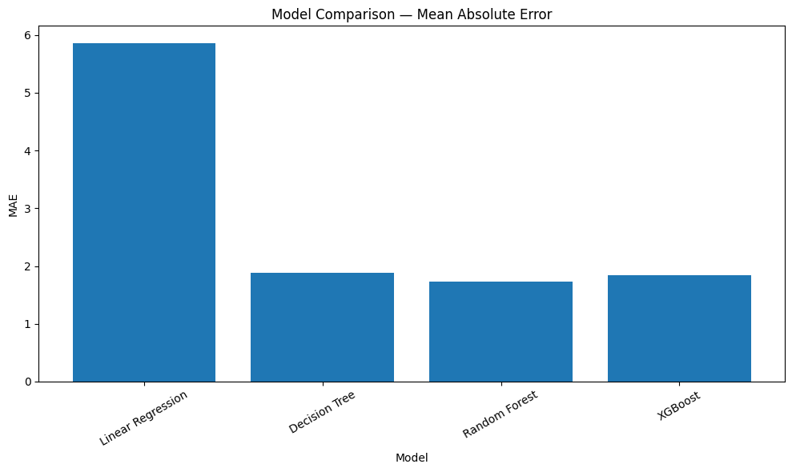
*MD Figure 1. Test MAE by model.*

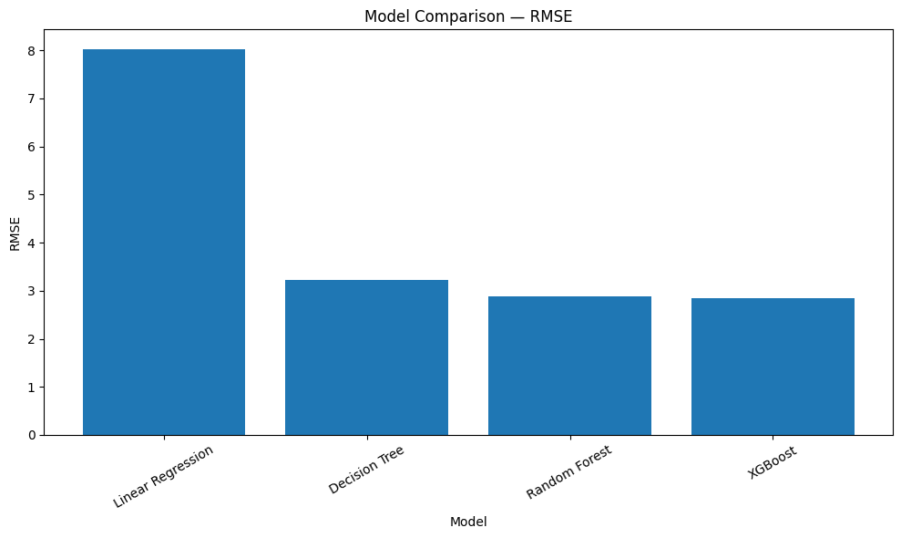
*MD Figure 2. Test RMSE by model.*

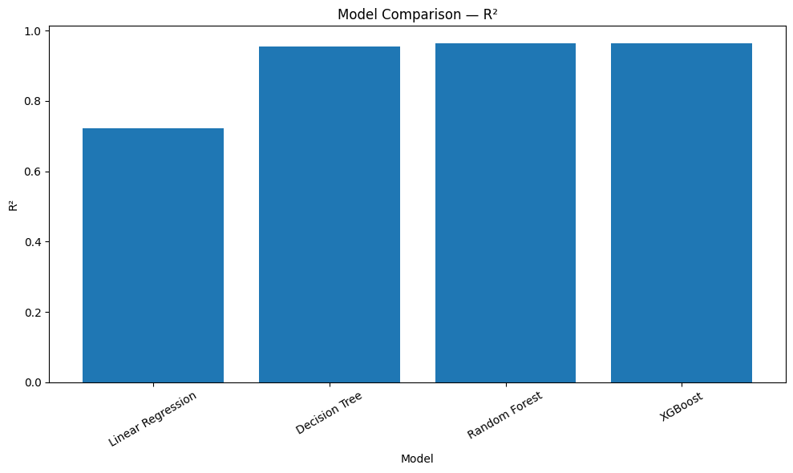
*MD Figure 3. Test R² by model.*

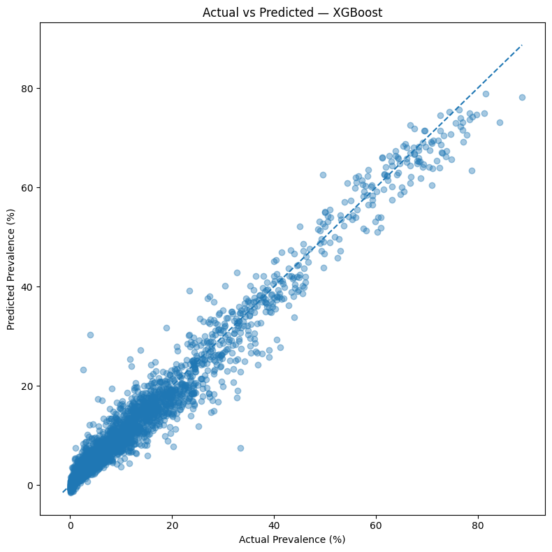
*MD Figure 4. XGBoost: actual vs predicted prevalence (%).*

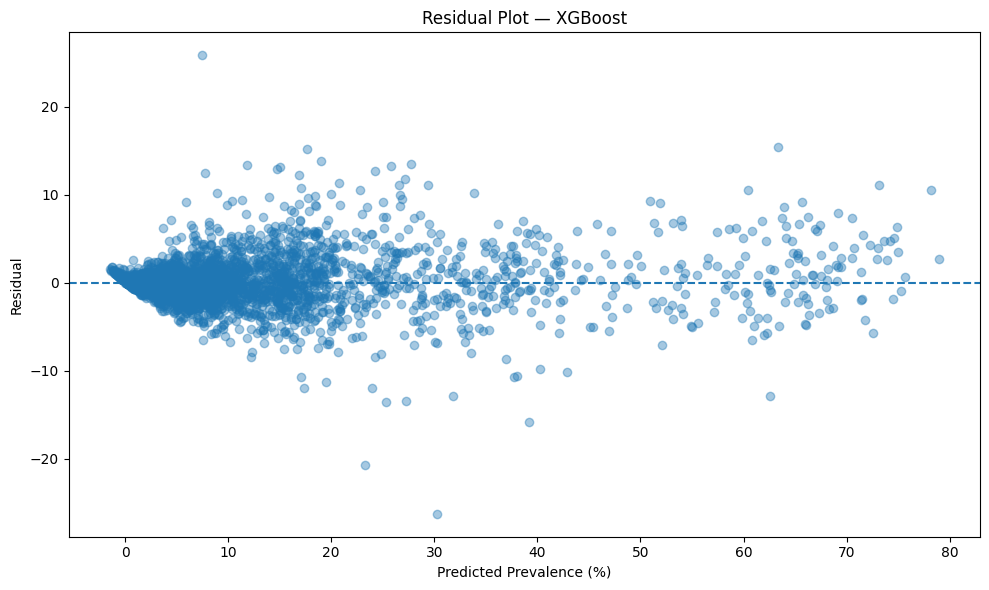
*MD Figure 5. XGBoost residuals vs predicted prevalence.*

## Feature Importance

Importance was calculated for all four models. Linear Regression ranked sparse categories highest, such as Kashmiri language (coefficient −17.5), Bhutan birthplace (+15.1) and Rohingya language (−13.4), so its ranking is driven by coefficient size on rare categories and is unreliable (MD Figure 6). The three tree-based models agreed with each other (MD Figures 7–9). A long-term health condition (LTHC) feature ranked first in all three (Decision Tree 0.459, Random Forest 0.441, XGBoost 0.275), and "Age group 65 and over" ranked second (0.301, 0.290, 0.253). Other contributors included the 45–64 age group, years in Australia (0–10), region and subregion class, and Auslan or sign-language use, each scoring below 0.06.

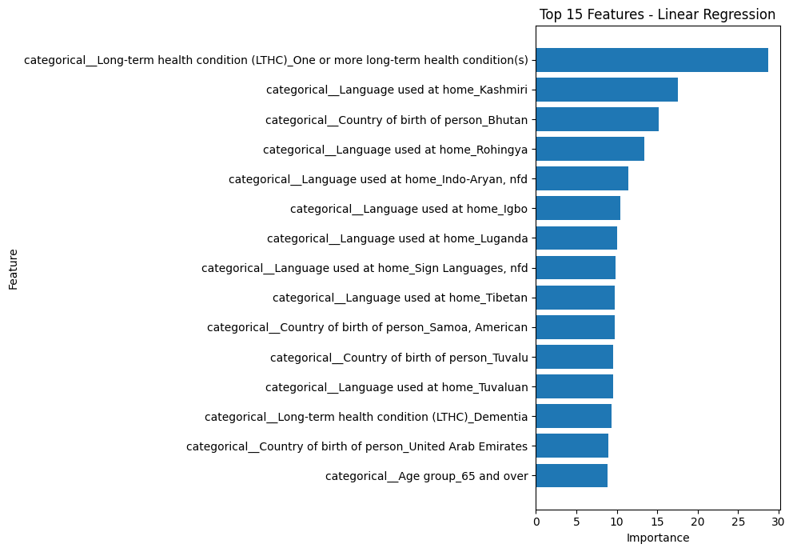
*MD Figure 6. Top 15 features: Linear Regression.*

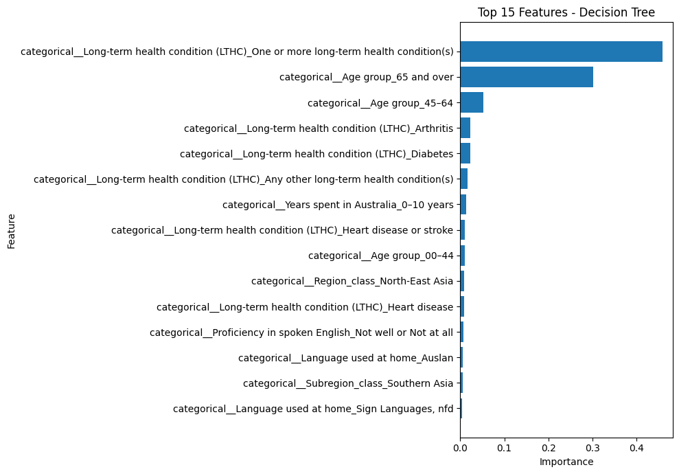
*MD Figure 7. Top 15 features: Decision Tree.*

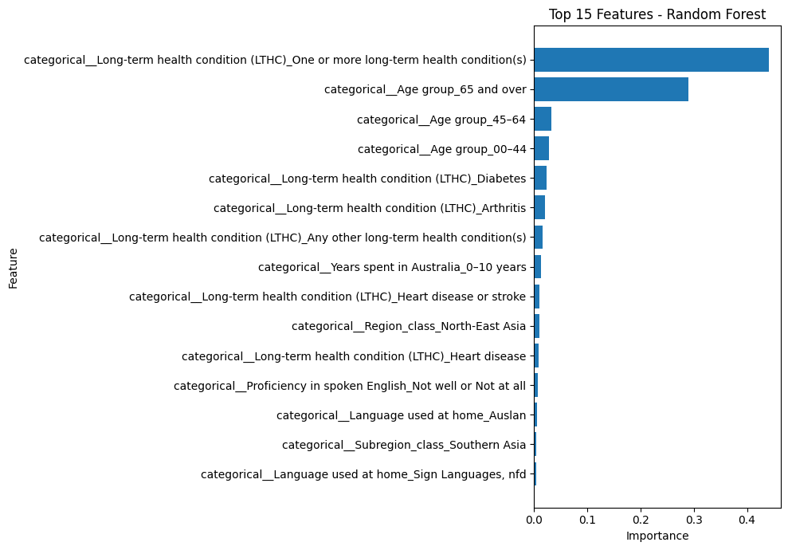
*MD Figure 8. Top 15 features: Random Forest.*

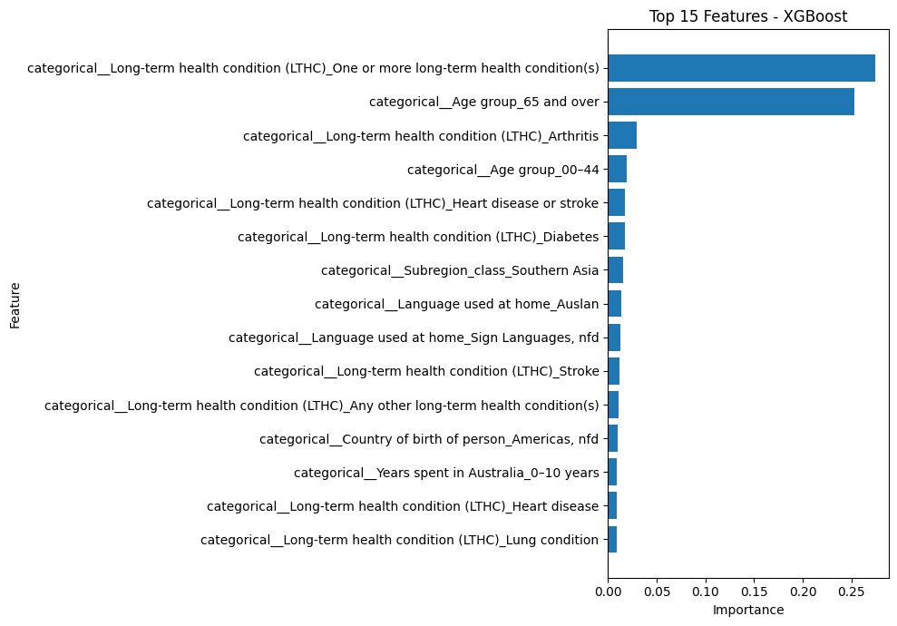
*MD Figure 9. Top 15 features: XGBoost.*

## Error Analysis

On the same test set the final XGBoost model scored MAE 1.834, RMSE 2.841 and R² 0.965 (MD Figure 10). Errors grew with prevalence: mean absolute error was 0.94 for the 0–5% group (1,254 cases), 1.51 for 5–10%, 2.22 for 10–20%, 3.72 for 20–50% and 3.64 for 50–100% (137 cases), which is visible as widening scatter in the residual plot (MD Figure 11). A few large misses drove the RMSE, the worst being a 26.3-point overprediction (actual 3.98, predicted 30.26) and a 25.8-point underprediction (actual 33.33, predicted 7.50). There was a slight overprediction bias: 54.07% of predictions (1,689) were too high and 45.93% (1,435) too low.

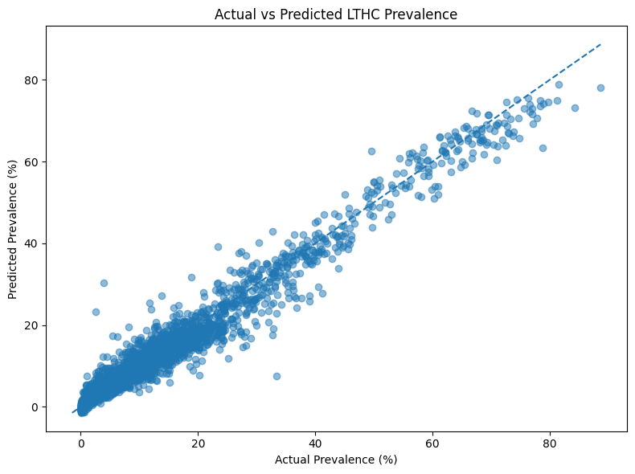

*MD Figure 10. Actual vs predicted LTHC prevalence (%).*

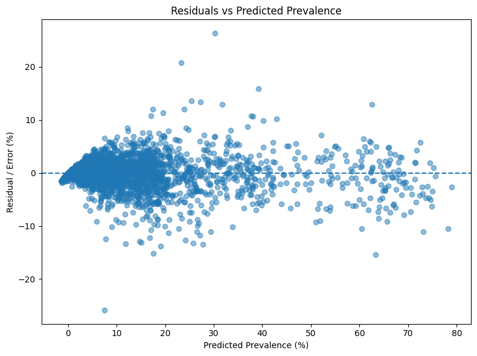
*MD Figure 11. Residuals (predicted − actual) vs predicted prevalence.*

## Missing artifact operational test
Part of the operation performance testing was in regards to identifying how our system would behave if an artifact file were not exist in the original folder. Hence, we tested this out on our FASTAPI (apiserver.py) by removing the pre-processor pickle file from the artifacts folder. The results were positive as the API didn’t instantiate and returned a detailed error that the specific file (lthc_preprocessor.pkl) was missing. This error was returned due to our CustomExeption catcher function and allows us to know the specific error and solve it immediately instead of trial and error. 

*MD Figure 12. Missing artifact error test result.*

## Sleeping API test on Dashboard
Our next operation test involved running the dashboard inference page whilst the API was asleep for our cloud version. The inference test returned an error  (502 error: Bad gateway) below due to the API cloud instance being asleep. This is a limitation based on the subscription type because our account is a free instance, hence after time of inactivity, the instance slows down and goes into sleep until it’s awoke again.  This test was beneficial as it informs us that the user output won’t be imaginery if the API is asleep and is a temporary limitation as it can be solved by upgrading to a new subscription tha has our two cloud service (API and Dashboard) running continously. 

*MD Figure 13. Sleeping API test on Dashboard.*

## Concurrency test
we ran a concurrency test on our cloud dashboard and api, on two different devices to determine if the dashboard can handle requests from multiple devices and the result figure can be found in the model_summary.md file, as both inference results were returned succesfully with any delay. Test was conducted on two different demographies
Laptop result:

Phone result: 

*MD Figure 14. Concurrency test.*
